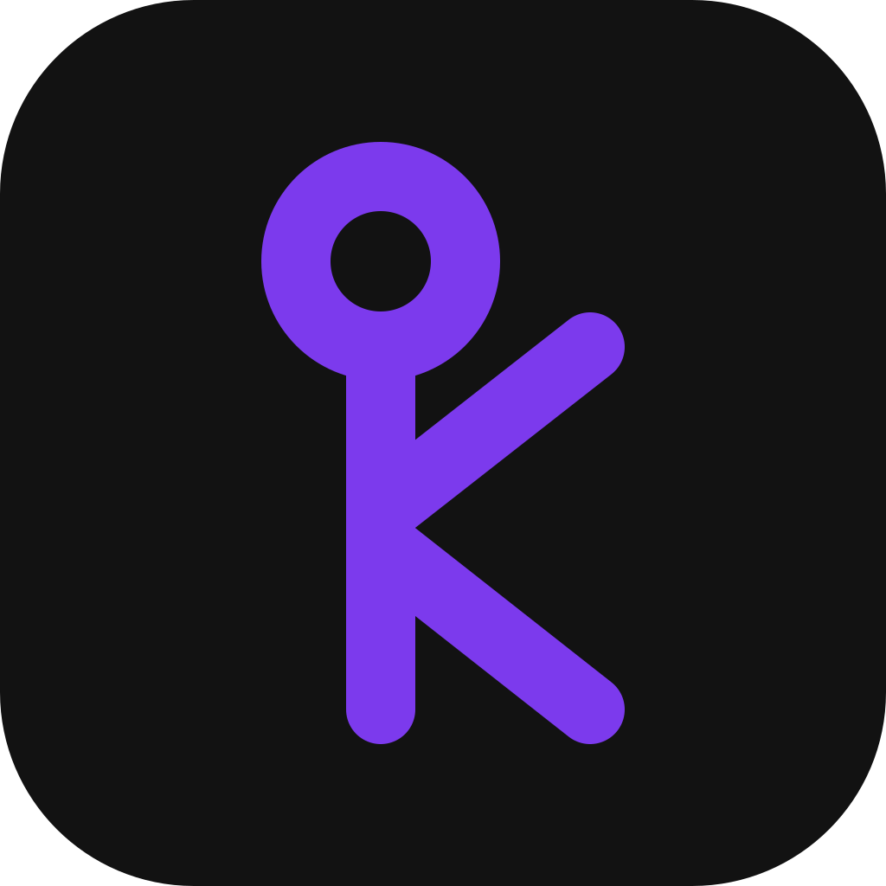

<p align="center">
  
</p>

<h1 align="center">kilog</h1>

<p align="center">
  Open-source achievement unlocker for Xbox and PC games.<br>
  Auto unlock, stat editing, and spoofing, on Windows, Android, and iOS.
</p>

<p align="center">
  <a href="https://www.rust-lang.org/"></a>
  <a href="LICENSE"></a>
  <a href="https://github.com/KlugesBuch1/kilog/stargazers"></a>
  <a href="https://github.com/KlugesBuch1/kilog/releases"></a>
</p>

<p align="center">
  <a href="#features">Features</a>
  &nbsp;·&nbsp;
  <a href="#event-based-games">Event-based games</a>
  &nbsp;·&nbsp;
  <a href="#settings">Settings</a>
  &nbsp;·&nbsp;
  <a href="#build">Build</a>
  &nbsp;·&nbsp;
  <a href="CONTRIBUTING.md">Contributing</a>
</p>

Unlocking achievements outside normal play can violate the Xbox terms of service and put the account at risk.

## Features

| Page | What it does |
| --- | --- |
| Home | Sign in with Microsoft. A saved session signs you back in. Anonymous mode hides your gamertag, gamerpic, and XUID. |
| Games | Browse the games on your account, search the list, and filter by completion. |
| Achievements | Open a title, filter its achievements, and unlock them from their cards. |
| Stats Editor | Load a title by Title ID and edit its stats. |
| Auto Unlock | Build a queue from a reference gamertag, set delays and skips, and unlock while that game is spoofed. The Xbox PC app has to be open and signed in, or spoofing fails. |
| Spoofing | Spoof played time for a title. The Xbox PC app has to be open and signed in. |
| Title search | Search any Xbox One, Xbox Series, or PC game by name or Title ID. |
| Gamerpic Downloader | Look up a gamertag and save its gamerpic to Downloads. |
| Settings | Region, spoofing, anonymous mode, and unlock delays. |

## Event-based games

Xbox titles unlock in one of two ways. Title-based games unlock through the achievements service. Event-based games unlock only when Xbox receives a specific event for that achievement.

Event-based games need to be mapped by hand, by sniffing traffic, dumping games, or guessing the patterns. That work is ridiculously tedious, which is why some games are not available yet.

On startup, kilog fetches the current event catalog into `Documents\kilog\events`. An event-based title can be unlocked only when both the template and its `Data.json` entry are present.

Some templates cover only part of a list. A title with no template, or a template with no catalog entry, cannot be unlocked.

Event templates are largely the work of [ethanwp28](https://github.com/ethanwp28).

## Settings

| Option | What it does |
| --- | --- |
| Force region | When on, Xbox requests use `en-US`. When off, they use the Windows locale. |
| Spoof games while on achievements page | Spoofs the opened game while on said page. |
| Anonymous mode | Hides your gamertag, gamerpic, and XUID on Home. |
| Randomize delays | Each tier can be turned on and sets its own range. Delays over 1 minute, 10 minutes, or 1 hour are shifted up or down by a random amount in that range. Delays over 5 hours are replaced by a random time inside the range. |

Auto Unlock also saves **Stop unlocking when spoofing fails** and **Use randomized delays** in `config.json`.

## Data

Session and settings live under `Documents\kilog`. `session.json` is a Microsoft refresh token. Keep that folder private.

| File | Contents |
| --- | --- |
| `session.json` | Microsoft refresh token, so you stay signed in |
| `config.json` | Settings |
| `queue.json` | Auto unlock queue, so a stopped run can resume |
| `events\` | Event catalog fetched on startup |

## Build

Install [Rust](https://rustup.rs/) with the MSVC toolchain, then:

```powershell
cargo build --release
```

The executable is `target\release\kilog.exe`.

Spoofing and auto unlock need the Xbox PC app open and signed in.

## Contributing

See [CONTRIBUTING.md](CONTRIBUTING.md).

## License

[GPL-3.0](LICENSE). If you distribute kilog or a modified version, share the source under the same license.
